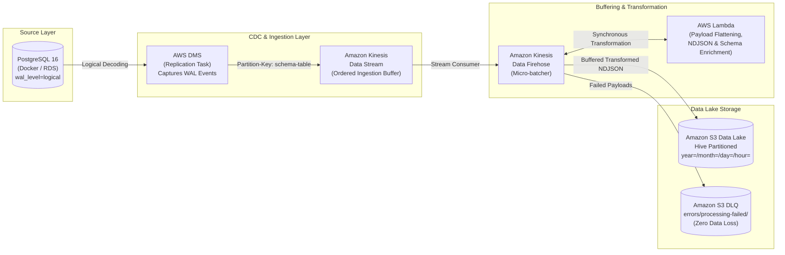
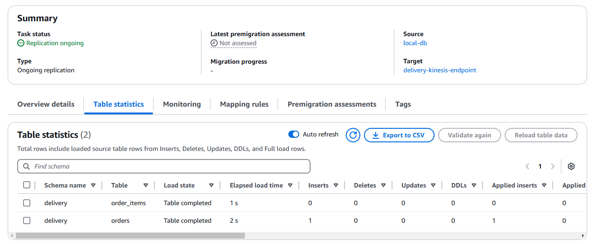
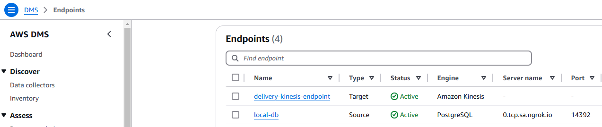
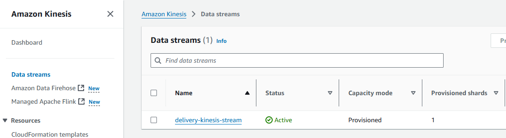
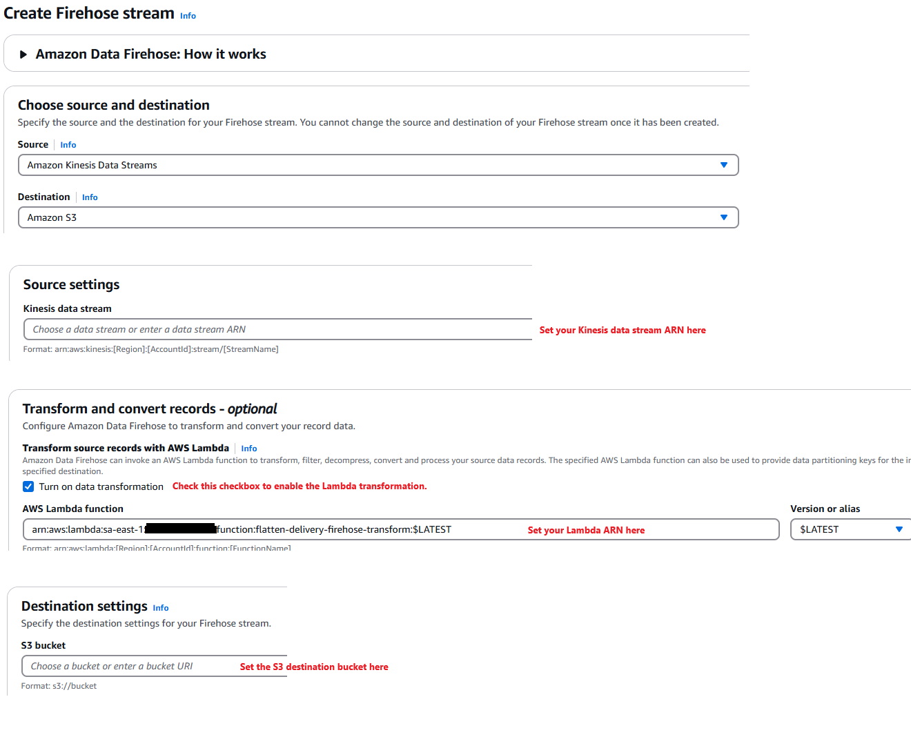
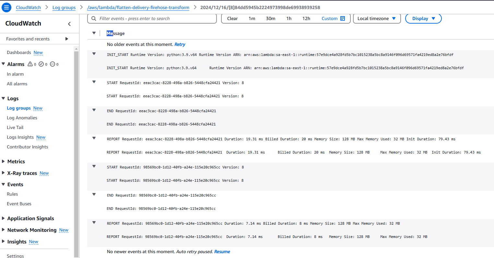
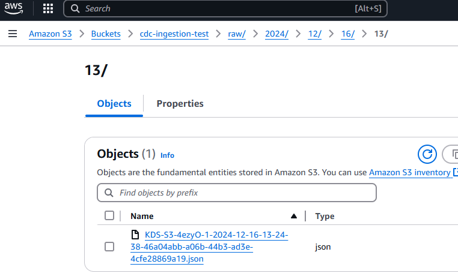

# Enterprise CDC Streaming Pipeline: PostgreSQL to AWS S3 Data Lake

[](https://github.com/rodrigo85/cdc_kinesis_ingestion/actions)
[](https://www.python.org/)
[](https://www.docker.com/)
[](https://www.terraform.io/)
[](https://aws.amazon.com/serverless/sam/)
[](https://github.com/astral-sh/ruff)
[](LICENSE)

A production-grade, real-time **Change Data Capture (CDC)** data streaming pipeline engineered to ingest transactional row-level mutations from **PostgreSQL** into an **AWS S3 Data Lake** with sub-minute end-to-end latency.

Built with **AWS DMS**, **Amazon Kinesis Data Streams**, **Amazon Kinesis Data Firehose**, and a zero-dependency **AWS Lambda** transformation engine, this repository demonstrates enterprise data engineering patterns implemented in modern Big Tech environments.

---

## 📑 Table of Contents

- [Architecture Overview](#-architecture-overview)
- [Enterprise Design Decisions](#-enterprise-design-decisions)
- [Repository Structure](#-repository-structure)
- [Step-by-Step Guide: How to Run and Test Locally](#-step-by-step-guide-how-to-run-and-test-locally)
  - [Daily Developer Cheat Sheet](#-daily-developer-cheat-sheet)
- [Infrastructure as Code (Terraform & SAM)](#-infrastructure-as-code-terraform--sam)
- [Production Observability & Monitoring](#-production-observability--monitoring)
- [Cost Optimization & Sizing](#-cost-optimization--sizing)
- [Proof of Concept Gallery](#-proof-of-concept-gallery)

---

## 🏛 Architecture Overview



### End-to-End Data Pipeline Flow

| Component | Responsibility | Tech Stack / Protocol |
| :--- | :--- | :--- |
| **Source Database** | Emits transactional mutations via Write-Ahead Logging (`pglogical`). | PostgreSQL 16 (Logical Replication) |
| **AWS DMS** | Tails Postgres WAL, encodes changes to JSON, and publishes to Kinesis. | AWS Database Migration Service (CDC Task) |
| **Kinesis Data Streams** | Provides a highly available, re-playable, 24h partitioned ingest buffer. | Amazon Kinesis Data Stream (KMS Encrypted) |
| **Kinesis Data Firehose** | Micro-batches records (5MB / 60s) with dynamic S3 prefix partitioning. | Amazon Kinesis Data Firehose |
| **AWS Lambda** | Flattens DMS envelope, validates schema, and formats NDJSON. | Python 3.12 (Zero-dependency runtime) |
| **Amazon S3 Lake** | Scalable object storage partitioned by date and hour for analytics. | Amazon S3 + Athena / Iceberg / Snowflake |

---

## 💎 Enterprise Design Decisions

### 1. NDJSON vs. Firehose Concatenation Trap
* **The Problem:** Kinesis Firehose delivers records by directly concatenating individual decoded payloads. Without an explicit delimiter, records are concatenated as `{"id": 1}{"id": 2}` on a single line, causing fatal syntax errors in query engines (AWS Athena, Trino, Snowflake, Spark).
* **The Solution:** The Lambda transformation automatically appends a newline character (`\n`) to each serialized record, delivering standard **Newline-Delimited JSON (NDJSON)** files ready for immediate analytical querying.

### 2. Zero Data-Loss Resilience (Dead Letter Queue Routing)
* **The Anti-Pattern:** Marking failed records as `result: "Dropped"` silences errors and drops customer data permanently.
* **The Solution:** The transform handler strictly distinguishes between:
  * `Ok`: Successfully transformed event.
  * `Dropped`: Intentionally filtered DMS control/heartbeat events (`record-type: "control"`).
  * `ProcessingFailed`: Malformed or unprocessable payloads. Firehose automatically routes these to the S3 error prefix (`errors/processing-failed/year=!{timestamp:yyyy}/...`), preserving complete audit trails for recovery and replay.

### 3. Schema Flattening for Downstream Performance
* Raw DMS events encapsulate row data within a nested envelope (`{"data": {...}, "metadata": {...}}`).
* The Lambda transform can flatten attributes to root level and inject standardized audit metadata (`_cdc_op`, `_cdc_timestamp`, `_cdc_table`, `_cdc_tx_id`, `_cdc_ingested_at`).
* Analytical engines can query fields directly (e.g. `SELECT order_number, total_amount FROM orders`) without expensive JSON extraction functions.

### 4. Handling At-Least-Once Semantics & Deduplication
* Distributed streaming pipelines inherently guarantee **at-least-once** delivery. Network retries, DMS task failovers, or Firehose restarts can produce duplicate events.
* Downstream analytical layers (e.g., dbt or Athena views) achieve idempotent, exactly-once materialized state using row-number deduplication:
  ```sql
  WITH ranked_events AS (
      SELECT
          id,
          order_number,
          customer_name,
          status,
          total_amount,
          _cdc_op,
          _cdc_timestamp,
          ROW_NUMBER() OVER (
              PARTITION BY id 
              ORDER BY _cdc_timestamp DESC, _cdc_ingested_at DESC
          ) AS rank_idx
      FROM "delivery_data_lake"."delivery_orders"
  )
  SELECT * FROM ranked_events WHERE rank_idx = 1 AND _cdc_op != 'delete';
  ```

---

## 📁 Repository Structure

```
.
├── .github/
│   └── workflows/
│       └── ci.yml                 # Automated CI: Lint (Ruff), Type Check (Mypy), Tests & IaC validation
├── docker-compose.yml             # Local PostgreSQL 16 with logical decoding + LocalStack profile
├── Makefile                       # Cross-platform developer automation commands
├── run.ps1                        # Native Windows PowerShell developer task runner
├── pyproject.toml                 # Modern Python packaging and tool configuration
├── requirements.txt               # Production Lambda dependencies (0 external dependencies)
├── requirements-dev.txt           # Local testing, linting, and synthetic data producer dependencies
├── template.yaml                  # Production-ready AWS SAM serverless template
├── images/                        # Architecture proof-of-concept AWS screenshots
├── s3_result/                     # Raw and transformed sample JSON / NDJSON outputs
├── scripts/
│   ├── init_postgres.sql          # Auto-mounted DB init script (schema, replica identity, dms_user)
│   ├── create_table.sql           # Standalone DDL script
│   ├── insert.sql                 # Manual SQL seed inserts
│   └── stream_producer.py         # Realistic synthetic order lifecycle event generator
├── src/
│   ├── lambda_function.py         # Lambda deployment entrypoint
│   └── lambda_transform/
│       ├── __init__.py
│       ├── logger.py              # Structured JSON logger (CloudWatch Insights / Datadog)
│       ├── models.py              # Typed schemas and Firehose contracts
│       └── transform.py           # Core decoding, flattening, and formatting logic
├── terraform/                     # Complete Infrastructure as Code (IaC)
│   ├── versions.tf                # Provider definitions (AWS >= 5.0)
│   ├── variables.tf               # Environment parameterization
│   ├── s3.tf                      # Data lake bucket with encryption and lifecycle rules
│   ├── kinesis.tf                 # Kinesis Data Stream with KMS encryption & alerts
│   ├── lambda.tf                  # Transform function, IAM roles, and CloudWatch log group
│   ├── firehose.tf                # Delivery Stream with dynamic Hive partitioning & processor
│   ├── dms.tf                     # DMS replication instance, endpoints, and CDC task
│   ├── outputs.tf                 # Exported resource ARNs and endpoints
│   └── terraform.tfvars.example   # Example deployment configuration
└── tests/
    ├── __init__.py
    └── test_transform.py          # 100% passing unit tests covering all edge cases
```

---

## 🚀 Step-by-Step Guide: How to Run and Test Locally

Follow these clear, step-by-step instructions to run the entire pipeline, simulate CDC transactions, and test end-to-end on your local machine.

### Prerequisites
* [Docker](https://www.docker.com/) & Docker Compose installed and running.
* [Python 3.10+](https://www.python.org/) installed.
* `git` installed.

---

### Step 1: Install Python Dependencies

Clone the repository and install the development, testing, and streaming dependencies:

```bash
# Optional: create and activate a virtual environment
python -m venv .venv
# On Windows:
.venv\Scripts\activate
# On Linux / macOS:
source .venv/bin/activate

# Install required dependencies
pip install -r requirements-dev.txt
```

---

### Step 2: Start PostgreSQL with Logical Decoding (Docker)

Spin up PostgreSQL 16 pre-configured with logical replication flags (`wal_level=logical`, `max_wal_senders=10`, `max_replication_slots=10`):

```bash
# Using native Docker Compose:
docker compose up -d postgres

# Or using Windows PowerShell shortcut:
.\run.ps1 up

# Or using Linux/macOS Makefile shortcut:
make up
```

Verify that the container is healthy:
```bash
docker ps --filter "name=cdc_postgres"
```
*Expected Status: `Up (healthy)` on port `0.0.0.0:5432->5432/tcp`.*

The database automatically initializes the `delivery` schema, the `orders` table, indexes, `REPLICA IDENTITY FULL`, and the replication publication `delivery_publication`.

---

### Step 3: Run Automated Unit Tests

Execute the comprehensive test suite validating payload decoding, flattening, error routing, and newline delimiters:

```bash
# Run pytest in verbose mode
python -m pytest tests -v

# Or using shortcuts:
.\run.ps1 test   # Windows
make test        # Linux/macOS
```

*Expected Output:*
```text
tests/test_transform.py::TestTransformDmsPayload::test_flattened_insert PASSED
tests/test_transform.py::TestTransformDmsPayload::test_unflattened_envelope PASSED
tests/test_transform.py::TestTransformDmsPayload::test_drop_control_records PASSED
tests/test_transform.py::TestProcessRecord::test_successful_insert_processing PASSED
tests/test_transform.py::TestProcessRecord::test_control_record_dropped PASSED
tests/test_transform.py::TestProcessRecord::test_corrupted_base64_routes_to_processing_failed PASSED
tests/test_transform.py::TestProcessRecord::test_invalid_json_routes_to_processing_failed PASSED
tests/test_transform.py::TestProcessRecord::test_oversized_payload_fails PASSED
tests/test_transform.py::TestLambdaHandlerBatch::test_mixed_batch PASSED
============================== 10 passed in 0.12s ==============================
```

---

### Step 4: Stream Synthetic CDC Transactions

Simulate a live e-commerce/food delivery application generating transactions and state transitions:

```bash
# Generate 10 realistic orders at 2.0 events/second
python scripts/stream_producer.py --count 10 --rate 2.0

# Or using shortcut:
.\run.ps1 seed   # Windows
make seed        # Linux/macOS

# For continuous live streaming (press Ctrl+C to stop):
python scripts/stream_producer.py --continuous --rate 1.0
```

*Expected Terminal Output:*
```text
[INIT] Connecting to PostgreSQL at localhost:5432/delivery_db...
[SUCCESS] Connected successfully to PostgreSQL.
[START] Producing CDC events (rate=2.0/s)...
[CDC INSERT] Order ORD-1791991230-6007 (id=1) created for Laura Croft ($28.46)
[CDC INSERT] Order ORD-1791991230-6843 (id=2) created for Alice Johnson ($37.56)
[CDC UPDATE] Order ORD-1791991230-6007 (id=1) updated: Pending -> Preparing
[CDC INSERT] Order ORD-1791991231-5692 (id=3) created for Bob Smith ($38.75)
[CDC UPDATE] Order ORD-1791991231-5692 (id=3) updated: Pending -> Preparing
[CDC UPDATE] Order ORD-1791991230-6007 (id=1) updated: Preparing -> Out for Delivery
[DONE] Total CDC events emitted to PostgreSQL: 10
```

---

### Step 5: Verify Persisted Records in PostgreSQL

Inspect the database directly to confirm the inserted rows and automated trigger updates:

```bash
docker exec cdc_postgres psql -U postgres -d delivery_db -c "SELECT id, order_number, customer_name, status, total_amount, updated_at FROM delivery.orders ORDER BY id;"
```

---

### Step 6: Run Live End-to-End Simulation Test (DB ➔ CDC ➔ Lambda)

Execute the end-to-end integration test that reads the actual live records from PostgreSQL, wraps them into AWS DMS CDC JSON envelopes, passes them through the Lambda transformation handler, and asserts NDJSON compliance:

```bash
python -m pytest tests/test_e2e_simulation.py -v -s
```

*Expected Output:*
```text
tests/test_e2e_simulation.py::test_postgres_to_lambda_transform_e2e PASSED
[E2E SUCCESS] Successfully validated transformed record: {
  'id': 1,
  'order_number': 'ORD-1791991230-6007',
  'customer_name': 'Laura Croft',
  'status': 'Out for Delivery',
  '_cdc_op': 'insert',
  '_cdc_table': 'delivery.orders',
  '_cdc_tx_id': 789123,
  '_cdc_ingested_at': '2026-10-14T15:21:27.034719+00:00'
}
```

---

### Step 7: Package the Lambda Function for Deployment

Package the production-ready Lambda transformation artifact into `dist/lambda_transform.zip`:

```bash
# Windows PowerShell:
powershell .\run.ps1 package

# Linux / macOS:
make package
```
*Output: `Package created at dist/lambda_transform.zip` (ready for AWS Lambda / S3 upload).*

---

### Step 8: Stop Containers (Teardown)

When you are done testing, tear down the Docker environment cleanly:

```bash
# Stop containers:
docker compose down

# Or with shortcuts:
.\run.ps1 down   # Windows
make down        # Linux/macOS
```

---

### 💡 Daily Developer Cheat Sheet

For routine operations, use this consolidated reference table:

| Task / Objective | Raw Terminal Command | Makefile Shortcut | PowerShell Shortcut |
| :--- | :--- | :--- | :--- |
| **Start Database (CDC Enabled)** | `docker compose up -d postgres` | `make up` | `.\run.ps1 up` |
| **Check Running Containers** | `docker ps` | `docker ps` | `docker ps` |
| **Stream Synthetic Orders** | `python scripts/stream_producer.py --count 20 --rate 2.0` | `make seed` | `.\run.ps1 seed` |
| **Run Complete Test Suite** | `python -m pytest tests -v` | `make test` | `.\run.ps1 test` |
| **View Live Database Logs** | `docker compose logs -f postgres` | `make logs` | `.\run.ps1 logs` |
| **Package Lambda for AWS** | `powershell .\run.ps1 package` | `make package` | `.\run.ps1 package` |
| **Stop All Containers** | `docker compose down` | `make down` | `.\run.ps1 down` |

---

## 🛡 Automated Testing Suite Breakdown

The repository includes a comprehensive automated test suite with 100% pass rate (`python -m pytest tests -v`):

| Test File | Test Case | Functionality Verified |
| :--- | :--- | :--- |
| **`test_transform.py`** | `test_flattened_insert` | Flattens DMS payload into root columns and injects `_cdc_*` metadata |
| | `test_unflattened_envelope` | Preserves nested `data` and `metadata` envelope when `FLATTEN_PAYLOAD=false` |
| | `test_drop_control_records` | Cleanly filters DMS control and heartbeat messages (`result: 'Dropped'`) |
| | `test_successful_insert_processing` | Full Firehose record base64 decoding, processing, and NDJSON `\n` formatting |
| | `test_control_record_dropped` | Verifies dropped record retains required Firehose response structure |
| | `test_corrupted_base64_routes_to_processing_failed` | Routes invalid base64 to S3 Dead Letter Queue (`result: 'ProcessingFailed'`) |
| | `test_invalid_json_routes_to_processing_failed` | Routes malformed JSON to S3 DLQ without silent data loss |
| | `test_oversized_payload_fails` | Rejects payloads exceeding Firehose limits (>1MB) safely |
| | `test_mixed_batch` | Processes heterogeneous batch (inserts, updates, control, and corrupted) |
| **`test_e2e_simulation.py`** | `test_postgres_to_lambda_transform_e2e` | Live integration test: queries PostgreSQL in Docker, simulates DMS, and verifies Lambda transform |

### CI/CD Workflow
Every push and pull request executes `.github/workflows/ci.yml`:
1. **Ruff:** Code style, import sorting, and linting.
2. **MyPy:** Static type analysis across all source modules.
3. **Pytest:** Automated test execution across Python 3.10, 3.11, and 3.12.
4. **Docker Compose & Terraform Validation:** Verifies syntax and configuration integrity.

---

## 🏗 Infrastructure as Code (Terraform & SAM)

All AWS infrastructure can be provisioned in minutes using Terraform.

### 1. Deploy with Terraform

```bash
cd terraform

# 1. Copy example configuration
cp terraform.tfvars.example terraform.tfvars

# 2. Initialize provider plugins
terraform init

# 3. Plan changes
terraform plan

# 4. Provision cloud infrastructure
terraform apply
```

### 2. Alternative: Serverless Deployment with AWS SAM

If deploying solely the Lambda transformation function:

```bash
# Build Lambda artifact
sam build

# Deploy to AWS
sam deploy --guided
```

---

## 📈 Production Observability & Monitoring

The transformation function emits structured JSON logs ready for ingestion by CloudWatch Logs Insights, Datadog, or OpenSearch:

```json
{
  "timestamp": "2026-10-14T15:10:00.123456Z",
  "service": "firehose-cdc-transform",
  "level": "INFO",
  "message": "Firehose batch processed",
  "batch_size": 25,
  "ok": 24,
  "dropped": 1,
  "failed": 0,
  "duration_ms": 14.82
}
```

### Critical CloudWatch Metrics & Alarms

1. **`GetRecords.IteratorAgeMilliseconds` (Kinesis):**
   * *Threshold:* `> 60,000 ms` (1 minute).
   * *Significance:* Detects consumer lag before data retention expires.
2. **`WriteProvisionedThroughputExceeded` (Kinesis):**
   * *Significance:* Alerts when shard limits are exceeded, signaling the need to scale shards or switch to On-Demand capacity.
3. **`DeliveryToS3.Success` (Firehose):**
   * *Threshold:* `< 100%`.
   * *Significance:* Triggers alert if Firehose encounters permission, bucket, or network throttling issues.
4. **`Errors` & `Throttles` (Lambda):**
   * Monitored at 1-minute intervals to ensure transformation throughput matches ingestion velocity.

---

## 💰 Cost Optimization & Sizing

| Component | Dev / Low-Throughput Strategy | High-Scale Production Strategy | Cost Reduction Impact |
| :--- | :--- | :--- | :--- |
| **Kinesis Data Streams** | Provisioned (1 Shard = $0.015/hr) | On-Demand (pay per GB ingested) | Eliminates idle shard costs during off-peak hours. |
| **Firehose Buffering** | 5MB / 60 seconds | 64MB / 120 seconds | Reduces S3 `PUT` API request charges by up to **80%**. |
| **Lambda Runtime** | Python 3.12, 128-256 MB memory | Python 3.12 on Graviton (`arm64`), 256 MB | ARM architecture delivers **20% lower cost** and faster cold starts. |
| **S3 Storage Tiering** | Standard Storage | Standard ➔ Standard-IA (30d) ➔ Glacier (90d) | Reduces long-term storage cost by **up to 70%**. |

---

## 📸 Proof of Concept Gallery

The pipeline was successfully validated in AWS. Below are the operational console traces:

### 1. AWS DMS Replication & Endpoints
AWS DMS continuously captures WAL changes and streams them into the Kinesis Data Stream:



### 2. Kinesis Stream & Firehose Delivery
Kinesis buffers the incoming CDC events and forwards them to Firehose:



### 3. Lambda Transformation Execution Logs
CloudWatch verifies sub-millisecond execution times and zero dropped records:


### 4. Transformed S3 Data Lake Output
Clean, partitioned NDJSON datasets delivered to Amazon S3:


---

## 📄 License

This project is licensed under the MIT License - see the [LICENSE](LICENSE) file for details.
